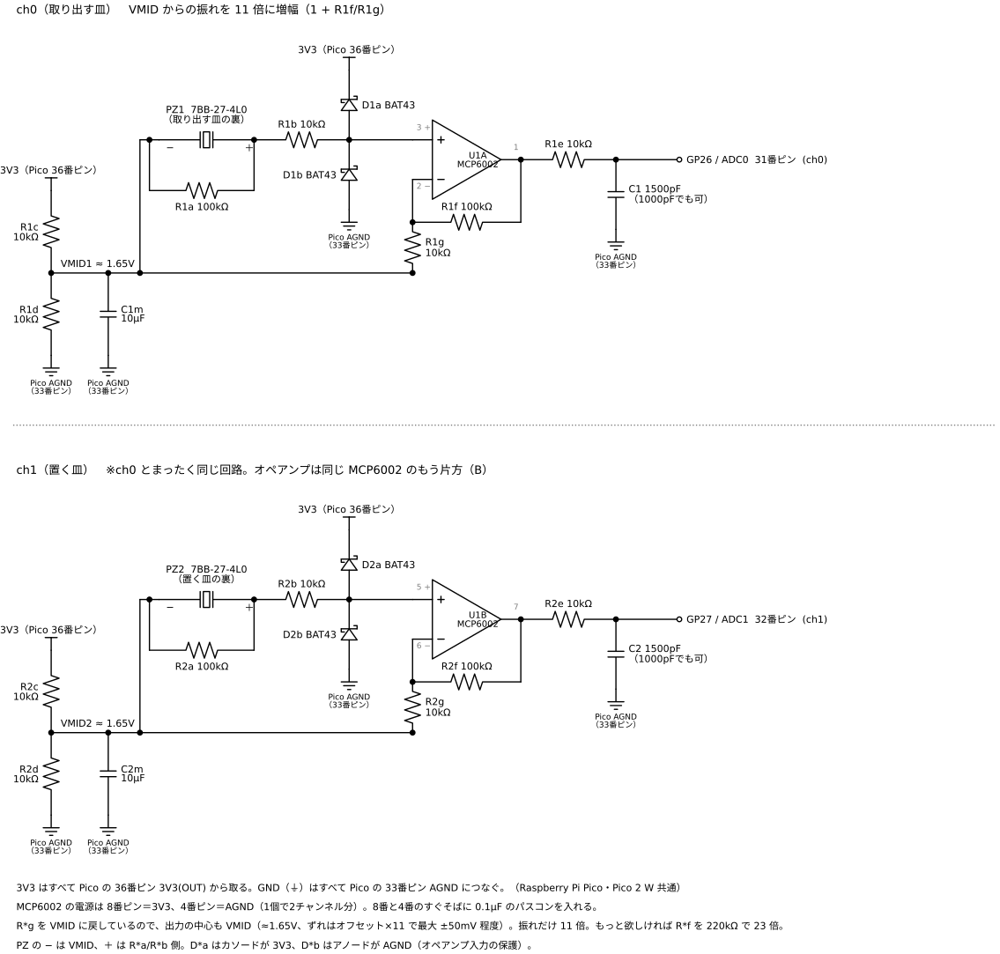

# kachi-sense　豆が落ちた「カチッ」で成否を判定するセンサー

[](https://github.com/tinycore-hisanori/kachi-sense/actions/workflows/ci.yml)

ロボットハンドで豆を1粒ずつ皿から皿へ移すとき、**移せたかどうかを音で自動判定**するための小さなセンサーと解析ソフトです。皿の裏に圧電素子を貼り、豆が着地したときの高い「カチッ」という音を拾います。

判定結果は、遠隔操作や学習のログと時刻で突き合わせて、試行ごとに `success / dropped / double / miss` のラベルを自動で付けます。人が録画を見返して手でラベルを付ける作業をなくし、ハンドの学習データを速く・正確に貯めるのが目的です。

> 第1回 GMOロボットハンドコンテスト（GMOインターネットグループ）への挑戦の一環として作っています。

## なぜ音なのか

- **カメラより確実**：豆は小さく、手やハンドの陰に隠れてしまうことがあります。着地の音は陰に隠れないので、見えない位置でも検出できます。デジタル信号処理（IIR フィルタ）で高い周波数の着地音だけを取り出し、ノイズやハンドの衝突音と分離します。
- **速い**：判定は着地から十数ミリ秒。学習中の報酬信号にも使えます。
- **安い・どこでも付く**：圧電素子1枚と、数個の抵抗とコンデンサだけ。皿の形も選びません。

一番の問題は、ハンドの指が皿に**コツン**と当たる音や、モーターのうなりを豆と間違えることです。kachi-sense はこれを周波数で見分けます。

```
            ┌─ 高域（1.5 kHz ハイパス）── 包絡線 ── 自動しきい値 ── イベント検出
圧電素子 ─ ADC ─┤                                                       │
            └─ 低域（400 Hz ローパス）── イベント中のピーク ───────────┤
                                                                    ▼
                                    高域ピーク ÷ 低域ピーク ≥ 2 → click（豆）
                                                         < 2 → thud（指・ハンドの衝突）
```

豆の着地は 2〜6 kHz で鳴ってすぐ消えます。指の衝突は 200 Hz 以下にエネルギーが集まります。この比で分けると、強くぶつけた衝突でも豆と間違えません。

### フィルタの設計

高域を取り出すフィルタは、**2次バターワースの IIR ハイパスフィルタ**（カットオフ 1.5 kHz、双二次フィルタ1段、転置直接形 II）です。

- **IIR を選んだ理由**：マイコン上で実時間に処理するためです。2次の双二次フィルタなら1サンプルあたりの乗算は5回で済み、浮動小数点の演算器を持たない RP2040 でも 20 kHz × 2 チャンネルを余裕で処理できます。遅延も小さく、着地から十数ミリ秒で判定が出ます。同じ切れ味を FIR で出すには数十〜数百タップが必要で、このマイコンには重すぎます。
- **バタワースにした理由**：通過域にリプルがなく平らなので、豆や皿によって着地音の周波数が 2〜6 kHz の範囲でずれても、振幅が変わりません。しきい値を1つに決めやすくなります。
- **急峻さに頼らない**：指の衝突音は、フィルタの切れ味ではなく、高域と低域（400 Hz の1次ローパスを2段）のピーク比で見分けています。そのため、2次という低い次数で足りています。

実機で波形を録ったら、次数とカットオフ周波数を詰める予定です。着地時刻の精度をさらに上げたい場合は、群遅延が平らなベッセル特性に替えることも検討しています。係数は `kachi_sense/dsp.py`（Python の基準実装）と `firmware/kachi_sense_pico/detector.h`（ファームウェア）で同じものを使い、テストで両者の一致を確認しています。

## いまの性能（模擬信号での検証）

実機での検証はこれからです。現時点では、豆の着地音・指の衝突・モーターのうなり・ノイズを再現した模擬信号でテストしています（`tests/`）。

| 条件 | 結果 |
|---|---|
| 小さな着地音（ノイズの約 15〜25 倍）38 回 | 38 回すべて検出、誤検出 0 |
| 指の衝突 5 回（強さ 2 段階） | 豆としての検出 0（すべて thud に分類） |
| 衝突の 30 ms 後に豆が着地 | 豆を検出 |
| 20 試行の模擬セッション（成功・落下・失敗が混在） | 自動ラベルが正解と 20/20 一致 |
| ファームウェア（C++）と Python 版の一致 | イベントの位置と種類が完全一致 |

## ハードウェア

- Raspberry Pi Pico 2 W（Pico / Pico W / Pico 2 でも同じ配線で動く）
- 圧電サウンダー 7BB-27-4L0 × 2：取り出す皿（ch 0）と置く皿（ch 1）の裏に貼る
- オペアンプ MCP6002 × 1：圧電素子の信号を 11 倍に増幅（2 回路入りで 2 チャンネル分）
- 抵抗・コンデンサ・ショットキーダイオード少々



部品はすべて秋月電子通商で揃います。販売コード付きの部品表は [docs/bom.md](docs/bom.md)、配線は [docs/wiring.md](docs/wiring.md) にあります。部品代は Pico 本体を除いて約 1,000 円です。

増幅なしの最初の回路（v1）は [docs/schematic.png](docs/schematic.png) にあります。皿への貼り方がよく、信号が十分大きければ v1 でも動きます。

各チャンネル 20 kHz でサンプリングし、Pico の上で検出まで済ませます。PC には検出したイベントだけを USB シリアルで送ります。置く皿で豆を検出すると、Pico の LED が光ります（Pico W / Pico 2 W では初期状態でオフ。`L` で切り替え）。

## 使い方

### 1. ファームウェアを書き込む

同じスケッチが Raspberry Pi Pico / Pico W（RP2040）と Pico 2 / Pico 2 W（RP2350）のどれでも動きます。違うのはボードの選択だけです。

#### Arduino IDE で書き込む（Arduino IDE 2.x）

1. **ボードの追加 URL を登録**：「ファイル」→「基本設定」の「追加のボードマネージャの URL」に次を貼る。
   `https://github.com/earlephilhower/arduino-pico/releases/download/global/package_rp2040_index.json`
2. **コアを入れる**：左のボードマネージャで `pico` を検索し、**Raspberry Pi Pico/RP2040/RP2350**（作者 Earle F. Philhower, III）をインストール。公式の「Arduino Mbed OS RP2040 Boards」ではないので注意。
3. **スケッチを開く**：このリポジトリを clone するか ZIP で落とし、`firmware/kachi_sense_pico/kachi_sense_pico.ino` を開く（`detector.h` も同じフォルダに必要。フォルダ名とスケッチ名は同じままにする）。
4. **ボードを選ぶ**：「ツール」→「ボード」→「Raspberry Pi Pico/RP2040/RP2350」→ 使うボード（Pico 2 W なら **Raspberry Pi Pico 2W**、初代なら Raspberry Pi Pico）。ほかの設定は初期値のままでよい。
5. **初回だけ BOOTSEL で接続**：Pico の BOOTSEL ボタンを押しながら USB につなぎ、離す。ポートは選ばなくてよい（「UF2 Board」と出ることもある）。
6. **書き込み**：「→」（書き込み）を押す。終わると Pico が再起動して USB シリアル（Windows は COM ポート）として出てくる。2回目からは、そのポートを選んで書き込みを押すだけで BOOTSEL は不要。
7. **動作確認**：シリアルモニタを 115200 bps で開く。起動時に `# kachi-sense 0.1.1 on RP2350, 150 MHz, 2 ch x 20000 Hz` のような行が出る（開くのが遅れたら `v` を送る）。`s` を送ると状態が出て、`samples` の数が増えていれば ADC が回っている。

豆を検出するたび 1 行の JSON が出ます。`t` で衝突（thud）の表示を切り替え、`s` で状態、`v` でバージョンを表示します。`L` で、置く皿の click で LED を光らせるかを切り替えます。Pico W / Pico 2 W は LED が無線チップにつながっていて、光らせるたびの通信ノイズを click と誤検出しやすいため、初期状態はオフです。

`s` の `dc=` は各チャンネルの入力の直流レベル（ADC の値、VMID なら約 2048）、`floor=` は雑音の大きさです。`dc` が 2048 から大きくずれていたら配線を、`floor` が大きければ雑音源を疑ってください。

うまくいかないとき：

- 書き込みでポートが見つからないと言われる → USB を抜いて BOOTSEL を押しながら挿し直し、もう一度書き込む。
- 何も表示されない → USB ケーブルが充電専用でないか確認する。ボードの選択が実物と合っていないと（RP2040 用を RP2350 に入れるなど）起動しない。

#### Arduino IDE を使わずに書き込む（UF2）

GitHub Actions が push のたびにファームウェアをビルドしているので、[Actions](https://github.com/tinycore-hisanori/kachi-sense/actions/workflows/ci.yml) の最新の実行から、Raspberry Pi Pico なら `kachi_sense-pico-uf2`、Pico 2 W なら `kachi_sense-pico2w-uf2` をダウンロードします（GitHub へのログインが必要です。RP2040 用と RP2350 用は互換がないので、ボードに合ったほうを使ってください）。BOOTSEL ボタンを押しながら USB につなぎ、出てきたドライブ（初代は `RPI-RP2`、Pico 2 系は `RP2350`）に `.uf2` をコピーすれば書き込み完了です。

### 2. PC で記録する

```bash
pip install -r requirements.txt
python -m kachi_sense.logger COM5 -o events.csv      # Linux/Mac は /dev/ttyACM0 など
```

時刻は PC の時計に合わせて記録するので、遠隔操作側のログとそのまま突き合わせられます。

### 3. 試行にラベルを付ける

遠隔操作側から、試行ごとの開始・つかんだ時刻・終了を `trials.csv` に書き出しておきます。

```csv
trial_id,t_start,t_grasp,t_end
trial00,1762100000.10,1762100000.90,1762100002.30
```

```bash
python -m kachi_sense.label events.csv trials.csv -o labels.csv
```

| ラベル | 意味 |
|---|---|
| `success` | 置く皿で着地音が 1 回 |
| `dropped` | つかんだ後に取り出す皿で着地音（落とした） |
| `double` | 置く皿で 2 回以上（2 粒運んだ、または跳ねた） |
| `miss` | 置く皿で音がない |

### ライブデモ画面（Web Serial）

Pico をパソコンにつないだまま、ブラウザで判定の様子を大きく表示できます。豆が置く皿に着地すると「成功」、取り出す皿に落ちると「落下」、指の衝突は「無視」として数え、皿が光ります。デモ動画の撮影用です。

- `docs/demo/index.html` を Chrome か Edge で開き、「Pico に接続」を押してポートを選ぶ（GitHub Pages を `main` の `/docs` で有効にすると https://tinycore-hisanori.github.io/kachi-sense/demo/ で開けます）
- ボードがなくても「デモモード」で模擬データの動きを見られます
- 「記録を保存（CSV）」で検出ログを保存できます

### ハードなしで試す

```bash
python tools/demo.py        # 模擬セッション 20 試行を判定して結果を表示
python -m pytest            # テスト一式（g++ があればファームウェアとの一致も確認）
```

## この先

このセンサーは、汎用ハンドで農作物を収穫するロボットに向けた最初の部品です。

1. **今**：豆の着地を音で判定し、学習データのラベル付けを自動化する
2. **次**：遠隔操作（VR）で集めたデータと合わせて「つまむ」動作を学習させる
3. **その先**：「つまむ」を MCP ツールとして公開し、AI からハンドを呼び出せるようにする
4. **ゴール**：同じハンドで野菜や果実を収穫する

## チーム

タイニーコア株式会社（東京）

- 安藤 久範：リーダー、ハードウェア・ファームウェア・全体設計
- 原田 恒平：ソフトウェア開発

## ライセンス

MIT License
